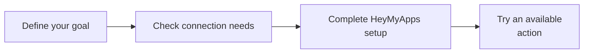

# Plan an account-information setup review without placing trades

**Alpaca + your AI assistant · powered by HeyMyApps**

You want an account-information setup review without placing trades, but first need to establish what Alpaca can support and what is ready in your account.

**Made for:** Teams inspecting an investment-app integration

This is a setup helper. You will need HeyMyApps and access to Alpaca to complete a connection.

## Ask your AI to set this up

Paste this into a coding assistant that can open project files and run commands, such as Codex, Claude Code or Grok Build. You do not need to understand the code first.

```text
Help me use this project: https://github.com/jannikco/alpaca-mcp

I'm not a programmer. My goal is: Plan an account-information setup review without placing
trades.

Read the project instructions and set it up in a new folder without overwriting my work.
Guide me through HeyMyApps and its private key setup; never ask me to paste secrets into this
chat. Start with the documented setup plan and explain what is still needed to connect my
app. Explain the result in plain English. Ask before changing records, sending messages or
publishing anything.
```

## Three useful things to ask for

```text
Help me plan an account-information setup review without placing trades with Alpaca.
Explain the setup steps in plain English.
```

```text
Compare that goal with the linked Alpaca documentation. Tell me whether an import, account
details or manual setup is still needed.
```

```text
Check which suitable actions are actually available in my HeyMyApps account. If none are
ready, stop with a missing-step checklist instead of pretending the business task has run.
```

## Your path to a real result



1. [Open the connection guide](https://heymyapps.com/github/start?app=alpaca&integration=alpaca-mcp&utm_source=github&utm_campaign=github-alpaca-mcp&utm_content=people-first-readme) and check whether the app is available or needs an API import.
2. Let your AI explain the required HeyMyApps account and provider permissions.
3. Run the documented setup check. A successful check is not proof that provider actions ran.

**What to expect:** You get a setup plan and connection checks. This project does not bundle a ready-made Alpaca action set. Importing an API or completing manual HeyMyApps settings may still be needed before any business task can run.

When your hosted integration publishes trading tools (for example `create_order`), those tools can place **real** orders. Use read-only discovery first, review each tool schema and confirm with a human before any write or trade.

Add your HeyMyApps key privately in your project settings (`HEYMYAPPS_API_KEY`; `PIPMCP_API_KEY` still works). Keep keys out of chat and public repositories.

## Keep going

- [Find another useful integration](https://github.com/jannikco/pipmcp-connectors)
- [Connect an API you control](https://github.com/jannikco/openapi-to-mcp)
- [Try the GitHub project](https://github.com/jannikco/github-mcp)

<details>
<summary>Technical reference: installation commands, exact capabilities and troubleshooting</summary>

<!-- people-first:technical:start -->
# Alpaca MCP setup and connection checker

**Prepare Alpaca for AI workflows with a HeyMyApps setup doctor, agent instructions and authenticated connector discovery.**

[Activate with HeyMyApps](https://heymyapps.com/github/start?integration=alpaca-mcp&app=alpaca&utm_source=github&utm_campaign=github-alpaca-mcp) · [Integration directory](https://heymyapps.com/connect/alpaca)

## Build something useful

Prepare Alpaca and inspect your hosted setup

This repository is a setup utility. Availability depends on your actual hosted integration and connection.

## Quick start

Requires Node.js 22+. Clone this repository, then:

```sh
npm ci --ignore-scripts
npm test
npm start
# After configuring your provider in HeyMyApps and setting HEYMYAPPS_API_KEY:
npm start -- --live
# Launch the stdio MCP bridge:
npm run server
```

Create a HeyMyApps API key with explicit `connectors:read` and `connectors:call` scopes. Set `HEYMYAPPS_API_KEY` in the calling process environment (`PIPMCP_API_KEY` is accepted as an alias). Provider credentials are configured in HeyMyApps. Multiple accounts require explicit `HEYMYAPPS_INTEGRATION_ID` and `HEYMYAPPS_CONNECTION_ID` from discovery (aliases: `PIPMCP_INTEGRATION_ID`, `PIPMCP_CONNECTION_ID`, `PIPMCP_CONNECTOR_ID`). Existing keys do not gain scopes automatically.

## Built for coding agents

Install this repository's skill into your project:

```sh
node lib/cli.mjs agents install --client codex --scope project --project /path/to/project
# Use claude or grok for those clients.
# Optional: --skill heymyapps-alpaca
```

Connect AI agents to Alpaca using one HeyMyApps API key and actual hosted tool discovery. Native AGENTS.md, CLAUDE.md and project skills support the current coding session. No additional AI model key is required. [capabilities.json](capabilities.json) describes the package; [llms.txt](llms.txt) indexes its instructions.

## Inspect actual tools before calling

```js
import {HeyMyAppsGatewayClient} from './lib/index.mjs';
const client = new HeyMyAppsGatewayClient(); // HEYMYAPPS_API_KEY or PIPMCP_API_KEY
const inventory = await client.getTools("alpaca");
console.log(inventory.data.tools);
// Select a real tool and validate your arguments against its returned schema.
// client.callTool(provider, actualToolName, reviewedArguments, {idempotencyKey});
```

`PipMCPGatewayClient` remains exported for compatibility. HeyMyApps enforces workspace, role, connection, policy/approval and usage controls. Published Alpaca tool sets can include order placement. Preserve the original idempotency key when retrieving/resuming a receipt. Pending and confirmation_required are not completed provider results; uncertain writes are held for reconciliation. The bridge never auto-approves a hosted action.

## Version 1 migration

This release uses the authenticated HeyMyApps gateway at `https://heymyapps.com/api/v1` for real discovery/execution (`pipmcp.com` redirects to the same product). Upgrade your MCP launch command and configure `HEYMYAPPS_API_KEY` before reconnecting. Historical local runtimes remain available under their original MIT license in Git history.

## Evidence and support

Transport, package and agent fixtures are tested. Authentication/provider access must be checked in your own configured workspace; synthetic fixtures do not establish live provider execution. Do not include credentials or customer records in public issues. MIT covers this public client.

## Use a manually imported API

If the provider is not already available in your workspace, import your reviewed API definition, publish the selected tools and configure its connection in HeyMyApps. Set `HEYMYAPPS_CONNECTOR_ID=custom-api` together with `HEYMYAPPS_INTEGRATION_ID` and, when needed, `HEYMYAPPS_CONNECTION_ID` (or the `PIPMCP_*` aliases). Then run `npm run doctor` or `npm run server`. These select your published private API; they do not change the fixed HeyMyApps origin or bypass hosted authorization. Leaving `HEYMYAPPS_CONNECTOR_ID` unset uses `alpaca`. Importing requires `integrations:read` and `integrations:write` on the same key; discovery and calls use `connectors:read` and `connectors:call`.

## Provider setup reference

[Official provider documentation](https://docs.alpaca.markets/us/openapi/trading-api.json). Credentials are entered in HeyMyApps; this package does not accept or store provider secrets.

<!-- people-first:technical:end -->

</details>